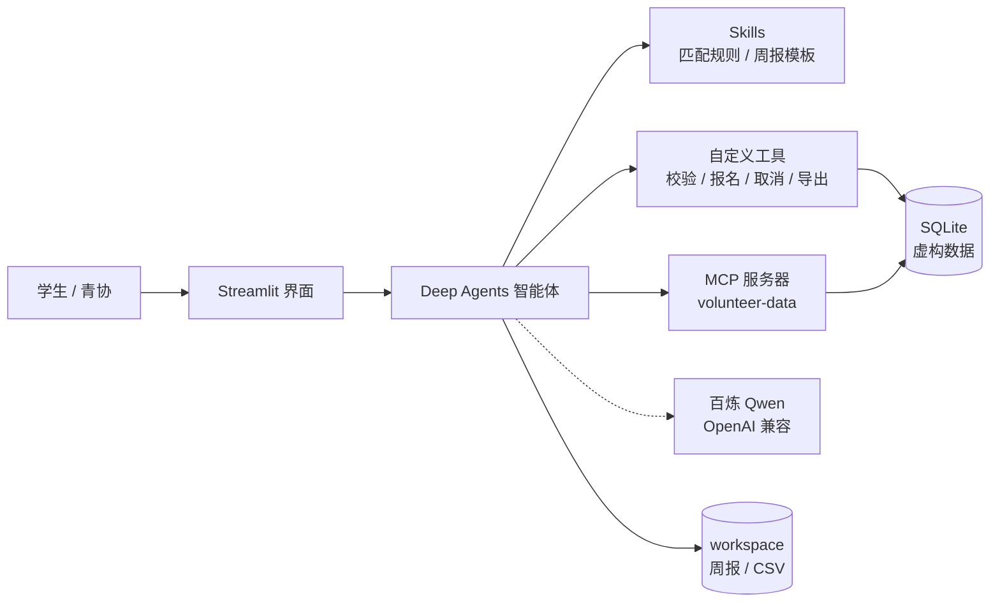

# 志愿星 · 校园志愿活动智能助手

《开源 AI 技术实践》期末项目：面向在校学生与院系青协，用自然语言完成「找活动 → 查时间冲突 → 确认报名 → 汇总志愿时长 → 生成周报」的完整闭环。

- 选题路径：**路径 A（技术栈完整）**，业务侧按路径 B 的闭环组织
- 小组成员：林至言（f25011330）、朱煜杰（f25011243）
- 当前状态：数据、工具、Agent、Skills、Streamlit 界面均已完成；无 Key 时可用离线演示跑通全流程
- 汇报材料：[presentation.html](presentation/presentation.html)；分工见 [docs/team-plan.md](docs/team-plan.md)；测试见 [docs/test-plan.md](docs/test-plan.md)

## 1. 问题与场景

校园志愿活动分散在群通知、表格和口头传达里：学生找不到适合自己的活动，报名后容易和课表撞车，学期末还要手工统计时长；组织方也缺少统一的报名与名额视图。

| 角色 | 需求 | 本项目的回应 |
|---|---|---|
| 学生 | 按时间、兴趣找活动并报名 | 自然语言检索、冲突检查、确认后报名 |
| 学生 | 学期末统计时长、交给辅导员 | 一键汇总并导出 CSV / 周报 |
| 青协与组织方 | 名额、报名情况可核对 | 名额实时计算、报名事务、幂等取消 |

**一句话主路径**：说出空闲时间和偏好，系统检索活动、检查课表冲突、确认后写入报名，并生成时长周报。

## 2. 演示话术（5 条）

| # | 话术 | 预期看到的工具链 |
|---|---|---|
| 1 | 我周三晚上有空，帮我找 2 个适合我的志愿活动 | `read_file(SKILL.md)` → `search_activities(weekday=周三)` → `get_activity_detail` |
| 2 | 帮我报名秋季运动会志愿保障，先看看会不会和课表冲突 | `check_schedule_conflict(A004)` → `enroll_activity`，暂停等待确认 |
| 3 | 帮我报名 A999 | `get_activity_detail(A999)` → 转述 `NOT_FOUND`，不编造活动 |
| 4 | 把这学期志愿时长汇总成周报，导出 CSV | `get_volunteer_hours` → `export_hours_csv` → `read_file(template.md)` → `write_file` → `task(report-critic)` |
| 5 | 取消我刚才的报名 | `cancel_enrollment`，暂停等待确认；确认后名额恢复 |

失败提示演示：说“报名晚自习陪伴辅导（A005）”，会得到 `FULL` 的中文提示，不写库。

> 演示主账号为 `S001 陈晓雨`、学期 `2026-2027-1`，累计 18.5 小时。`S001` 周三 18:00–19:40 有“数据结构”课，用于冲突演示。

## 3. 总体架构



| 层 | 职责 | 实现位置 |
|---|---|---|
| 界面层 | 对话、流式输出、执行过程面板、确认弹窗、历史会话 | `web.py` |
| 智能体层 | 规划、选择工具、子代理审阅、长期记忆 | `volunteer/agent.py` |
| 能力层 | 自定义工具、MCP 服务器、Skills | `volunteer/tools_business.py`、`volunteer/mcp_server.py`、`volunteer/skills/**` |
| 数据层 | SQLite 表结构、虚构样例、名额与冲突计算 | `data/**` |
| 产出层 | 周报 Markdown、时长 CSV，限制在 `workspace/` | `workspace/**` |

## 4. 技术栈

| 层次 | 选型 | 负责人 |
|---|---|---|
| 模型 | OpenAI 兼容服务：百炼 Qwen / 火山方舟 DeepSeek，按 `.env` 切换 | 林至言 |
| Agent 框架 | LangChain Deep Agents（含 Skills / Memory / 子代理） | 林至言 |
| 界面 | Streamlit（流式对话 + 执行过程面板 + 会话历史） | 林至言 |
| 工具与 MCP | Python 标准库 + MCP Python SDK（`mcp>=2.0.0`） | 朱煜杰 |
| 数据 | SQLite（`sqlite3`，无外部服务） | 朱煜杰 |
| 产出 | Markdown 周报、UTF-8-SIG CSV | 共同 |
| 测试 | `unittest`，含 MCP stdio 真实联调 | 朱煜杰 |

## 5. 目录结构

```text
final-exam/
├─ data/                     # 建表 SQL、虚构样例数据与初始化脚本
│  ├─ schema.sql
│  ├─ seed.py
│  └─ *.db                   # 业务库 / 聊天记录 / 检查点（seed 生成，不提交）
├─ volunteer/                # 业务代码
│  ├─ config.py              # 路径与环境变量
│  ├─ db.py                  # SQLite 连接与统一错误结构
│  ├─ tools_business.py      # 7 个业务工具（3 读 + 3 写 + 1 导出）
│  ├─ cli.py                 # 独立命令行工具（不依赖大模型）
│  ├─ mcp_server.py          # MCP 服务器 volunteer-data（3 个只读工具）
│  ├─ agent.py               # 智能体：模型接入、Deep Agent、人工确认、离线演示
│  ├─ sessions.py            # 会话与消息持久化
│  └─ skills/                # 两个 Skill
│     ├─ activity-matching/SKILL.md
│     └─ volunteer-weekly-report/{SKILL.md,template.md}
├─ scripts/
│  ├─ smoke_tools.py         # 工具冒烟脚本
│  ├─ check_data.py          # 演示数据完整性检查
│  ├─ mcp_smoke.py           # MCP stdio 联调（真实拉起服务器）
│  ├─ check_agent.py         # Agent 构造与工具挂载自检
│  └─ smoke_ui.py            # 界面冒烟
├─ tests/
│  ├─ test_tools.py          # 工具层单元测试
│  └─ test_mcp_server.py     # MCP 服务器测试
├─ workspace/                # 运行产出（不提交）
├─ web.py                    # Streamlit 界面入口
├─ AGENTS.md                 # 长期记忆（只存偏好，不存个人信息）
├─ docs/
│  ├─ team-plan.md           # 分工与协作方案
│  └─ test-plan.md           # 测试用例表
└─ presentation/             # HTML 汇报幻灯片
```

## 6. 数据层

| 表 | 关键字段 | 说明 |
|---|---|---|
| `students` | student_id、name、grade、major、interests、available_slots | 学生画像与空闲时段 |
| `courses` | student_id、name、weekday、start_time、end_time、weeks | 课表，用于冲突检测 |
| `activities` | activity_id、title、category、date、weekday、start_time、end_time、capacity、credit_hours、status | 活动与名额 |
| `enrollments` | enrollment_id、student_id、activity_id、status、created_at | 报名，`cancelled` 保留记录 |
| `hours` | student_id、activity_id、hours、term、status | 已认定时长 |

设计要点：

- 剩余名额不落库，由 `capacity - 已确认报名数` 实时计算，避免数据漂移
- 报名在单个事务内完成，依次校验学生、活动状态、重复报名、名额、时间冲突
- 取消为软删除（`status='cancelled'`），重复取消幂等
- 星期由日期推导，导入时校验一致性

演示数据全部虚构：20 名学生、30 条活动（24 开放 / 6 已结束）、40 条报名、6 条时长记录。

| 固定事实 | 用途 |
|---|---|
| `S001` 累计 18.5 小时 | 周报与导出的预期结果 |
| `S001` 周三 18:00–19:40“数据结构” | 演示课表冲突 |
| `A005` 名额 2 且已满 | 演示 `FULL` 失败提示 |
| `A026` 等 6 条已结束活动 | 验证检索只返回开放活动 |

## 7. 工具与 MCP

| 工具 | 类型 | 说明 |
|---|---|---|
| `search_activities(weekday, category, keyword, limit)` | 读 / MCP | 按星期、类别、关键词检索开放活动，返回剩余名额 |
| `get_activity_detail(activity_id)` | 读 / MCP | 活动详情与剩余名额 |
| `get_volunteer_hours(student_id, term)` | 读 / MCP | 学期时长汇总与明细 |
| `check_schedule_conflict(student_id, activity_id)` | 写前校验 | 课表与已报名活动的时间冲突 |
| `enroll_activity(student_id, activity_id)` | 写（需确认） | 事务内报名，拒绝冲突 / 满员 / 重复 |
| `cancel_enrollment(enrollment_id)` | 写（需确认） | 取消报名，幂等 |
| `export_hours_csv(student_id, term, out_path)` | 产出 | 写入 `workspace/`，UTF-8-SIG 编码 |
| `write_file(path, content)` | 产出（编排层） | 写周报等 Markdown，只允许 `workspace/` |

前三个在 `volunteer/mcp_server.py` 中注册；`agent.py` 直接复用 MCP 服务器注册的定义挂到模型上，所以“Agent 用的读工具”和“其他 MCP 客户端看到的工具”是同一套。

统一错误结构：

```json
{"error": {"code": "CONFLICT", "message": "时间冲突：数据结构"}}
```

错误码：`NOT_FOUND`、`CONFLICT`、`FULL`、`ALREADY_ENROLLED`、`CLOSED`、`INVALID_PATH`。

## 8. 智能体与 Skills

```powershell
python -m volunteer.agent --tools            # 打印挂载的工具清单
python -m volunteer.agent --ask "我周三晚上有空，有哪些活动"   # 需要 Key
python -m volunteer.agent --offline          # 不需要 Key，跑预置流程并写周报
```

| 组件 | 位置 | 作用 |
|---|---|---|
| 系统提示 | `volunteer/agent.py` 的 `SYSTEM_PROMPT` | 角色、工具边界、回答风格；每轮拼上学生档案 |
| Skills | `volunteer/skills/**` | 由 Skills 中间件发现并写入提示词，需要时才 `read_file` 读取 |
| 子代理 critic | `critic_instructions()` | 写完周报后核对数字与格式（固定输出“结论 / 问题”两行） |
| 长期记忆 | `AGENTS.md` | Memory 中间件自动注入；可写，用于追加稳定偏好（只放偏好，不放个人信息） |
| 人工确认 | `enroll_activity` / `cancel_enrollment` | 工具内部 `interrupt`，界面点“确认执行”才继续 |
| 文件权限 | `build_agent()` 的 `permissions` | 业务产出只写 `/workspace/**`；`AGENTS.md` 可读写；`.env`、`.venv`、`data/` 禁读写 |
| 会话 | `data/agent_state.db` + `data/volunteer_sessions.db` | 检查点续聊 + 聊天记录切历史 |

两个 Skill 的差别（答辩常问）：

- `activity-matching`：**怎么挑**——硬条件过滤、五维评分、输出模板。
- `volunteer-weekly-report`：**怎么写**——章节顺序、数字来源、自检清单、页脚声明。
- 系统提示负责“必须调用工具、不能编造”这类**行为约束**；Skill 负责“业务规则与写作规范”这类**知识**，体积大、按需读取，不占每轮上下文。

## 9. 界面与会话

- `web.py` 提供流式对话、执行过程面板、报名/取消确认弹窗、历史会话切换
- 左侧可切换“运行模式”：真实模型（需 Key）或离线演示（预置流程，用同一批工具真实写文件）
- 会话按 ID 保存，重启后可继续；聊天记录与检查点分库存储

## 10. 安装与运行

环境要求：Python 3.10 及以上（开发环境 3.13）、Windows PowerShell 或 CMD。

```powershell
# 1. 创建并激活虚拟环境
python -m venv .venv
.\.venv\Scripts\Activate.ps1

# 2. 安装依赖
python -m pip install -r requirements.txt

# 3. 配置模型（复制后填入自己的百炼 Key）
Copy-Item .env.example .env
notepad .env

# 4. 生成虚构演示数据（创建 data/volunteer_demo.db）
python -m data.seed

# 5. 逐个调用工具并打印 JSON
python -m scripts.smoke_tools

# 6. 数据完整性检查（汇报前自检）
python -m scripts.check_data

# 7. 命令行走完整业务闭环（临时数据库，不污染演示数据）
python -m volunteer.cli demo

# 8. MCP 联调：真实启动 stdio 服务器并调用 3 个工具
python -m scripts.mcp_smoke

# 9. 单元测试与 Agent / 界面自检
python -m unittest discover -s tests -v
python -m scripts.check_agent
python -m scripts.smoke_ui

# 10. 不启动界面，直接在终端跑离线演示
python -m volunteer.agent --offline

# 11. 启动界面
streamlit run web.py
```

> 若提示找不到 `streamlit` 命令，用 `.\.venv\Scripts\python.exe -m streamlit run web.py`。
> 没有 Key 也能演示：界面左侧把“运行模式”切到 **离线演示（预置流程）**，它会用同一批工具跑预置流程并真实写出周报。

启动 MCP 服务器（stdio）：

```powershell
python -m volunteer.mcp_server
```

在支持 MCP 的客户端中配置：

```json
{
  "mcpServers": {
    "volunteer-data": {
      "command": "python",
      "args": ["-m", "volunteer.mcp_server"],
      "cwd": "<仓库根目录>"
    }
  }
}
```

> MCP 使用 stdio 传输，服务器不向 stdout 打印日志；调试信息写 stderr。

独立命令行走查（不依赖大模型，可作为断网兜底）：

```powershell
python -m volunteer.cli search --weekday 周三 --limit 3
python -m volunteer.cli detail A001
python -m volunteer.cli hours S001
python -m volunteer.cli conflict S001 A004
python -m volunteer.cli enroll S001 A001          # 交互确认
python -m volunteer.cli enroll S001 A001 --yes    # 跳过确认
python -m volunteer.cli cancel E1001 --yes
python -m volunteer.cli export S001 --out hours.csv
python -m volunteer.cli --json hours S001
```

危险操作默认要求确认；非交互环境必须显式加 `--yes`。

### 容器化部署（可选）

仓库提供 [Dockerfile](Dockerfile) 与 [docker-compose.yml](docker-compose.yml)，镜像内会重建演示数据，`workspace` 挂载到宿主机。

```powershell
# 需要先启动 Docker Desktop
docker compose up --build
# 或
docker build -t volunteer-agent .
docker run --rm -p 8501:8501 volunteer-agent
```

打开 `http://localhost:8501`。在线模式仍需通过 `--env-file .env`（compose 已自动读取）提供百炼 Key；没有 Key 时用界面左侧的离线演示。

> 该路径在开发机上未完成构建验证（本机 Docker 守护进程未启动），现场演示请以本地 `streamlit run web.py` 为准。

## 11. 配置

复制 `.env.example` 为 `.env`，填入自己的百炼 Key。`.env` 已被 `.gitignore` 排除，**不要提交**。

| 变量 | 必填 | 说明 |
|---|---|---|
| `DASHSCOPE_API_KEY` | 是 | 百炼 Key（`sk-...`）；也接受 `OPENAI_API_KEY` |
| `OPENAI_BASE_URL` | 否 | 默认 `https://dashscope.aliyuncs.com/compatible-mode/v1` |
| `MODEL_NAME` | 否 | 默认 `qwen3.7-plus`；换模型只改这一行 |
| `MODEL_TEMPERATURE` | 否 | 默认 `0.2`，演示时保持低温度更稳定 |
| `MODEL_DISABLE_THINKING` | 否 | 默认 `1`，关闭推理模型的“思考”开关，避免工具参数被写进思维链 |
| `VOLUNTEER_DB` | 否 | 业务库路径，默认 `data/volunteer_demo.db` |
| `WORKSPACE_DIR` | 否 | 产出目录，默认 `workspace` |
| `VOLUNTEER_SESSIONS_DB` | 否 | 聊天记录库，默认 `data/volunteer_sessions.db` |
| `VOLUNTEER_STATE_DB` | 否 | 检查点库，默认 `data/agent_state.db` |

## 12. 测试与自检

| 检查 | 命令 | 当前结果 |
|---|---|---|
| 工具与 MCP 单元测试 | `python -m unittest discover -s tests -v` | 30 项通过 |
| 演示数据完整性 | `python -m scripts.check_data` | 11 项全部 PASS |
| MCP stdio 联调 | `python -m scripts.mcp_smoke` | 通过（工具清单、调用结果、只读边界） |
| 命令行业务闭环 | `python -m volunteer.cli demo` | 六步全部成功 |
| Agent 构造自检 | `python -m scripts.check_agent` | 14 项全部 PASS |
| 界面冒烟 | `python -m scripts.smoke_ui` | 6 项全部 PASS |

用例细节见 [docs/test-plan.md](docs/test-plan.md)。TC-19～TC-24（Agent 层）已用火山方舟 `deepseek-v4.1-flash` 实测通过，记录见该文档第 6 节。

## 13. 当前进度

| 模块 | 状态 | 负责人 |
|---|---|---|
| 数据层与样例数据 | 已完成 | 朱煜杰 |
| 7 个业务工具 + `write_file` | 已完成 | 朱煜杰 / 林至言 |
| MCP 服务器（3 个只读工具） | 已完成 | 朱煜杰 |
| 命令行闭环 | 已完成 | 朱煜杰 |
| 单元测试与联调脚本 | 已完成 | 朱煜杰 |
| Agent 编排、人工确认、长期记忆 | 已完成 | 林至言 |
| 两个 Skills 与判定 critic | 已完成 | 林至言 |
| Streamlit 界面与会话保存 | 已完成 | 林至言 |
| 离线演示模式 | 已完成 | 林至言 |
| 周报 Markdown 与 CSV | 已完成 | 共同 |
| HTML 幻灯片 | 初稿完成，待补真实截图 | 共同 |
| 演示脚本与录屏分镜 | 已完成 | 朱煜杰 |
| 容器化部署（可选） | 文件已提供，待本机验证构建 | 朱煜杰 |
| Agent 联调记录（TC-19～24） | 已完成 | 共同 |
| 备份录屏（≤3 分钟） | 未开始 | 朱煜杰 |

**路径 A 最低配置**：7 项均已具备（模型接入、Deep Agents、工具/MCP、Skills、界面、会话保存、产出物）。

## 14. 相对课堂 demo 的增量

| 课堂实验 | 复用的能力 | 本项目的落地 |
|---|---|---|
| demo_1 | Streamlit、RAG 思路 | 界面与本地知识组织 |
| demo_2 | OpenAI 兼容、Tool Calling、流式 | 工具协议、流式输出 |
| demo_3 / demo_4 | 百炼接入、密钥管理 | 模型接入、`.env` 隔离 |
| demo_5 | Deep Agents、Skills、MCP、记忆 | 骨架参考；自建 MCP 与业务工具 |

具体增量：

- 新的校园志愿业务场景与完整业务闭环，不是 demo_5 换皮
- 自建 `volunteer-data` MCP 服务器（3 个只读工具），Agent 直接复用其注册定义
- 确定性数据层：名额实时计算、报名事务、冲突检测、幂等取消
- 4 个自定义工具 + `write_file`，产出写入 `workspace/` 并限制目录
- 两个自写 Skill；报名 / 取消走 `interrupt` 人工确认
- 文件权限：业务产出只能写 `workspace/`；`AGENTS.md` 可写（长期偏好）；拒绝 `.env`、`.venv`、`data/`
- 会话双库设计；离线演示：无 Key 环境也能用同一批工具跑通并写出周报

> 演示中若让智能体“记住”偏好，`AGENTS.md` 会被修改。演示结束后执行
> `git checkout -- AGENTS.md` 恢复基线，避免提交演示时产生的临时偏好。

## 15. 合规与隐私

- 全部数据为虚构样例，不使用真实学号、手机号、成绩
- 不提供代写、作弊、监控或人肉检索能力
- 报名与取消需人工确认；Agent 只允许写 `workspace/`
- 密钥只放 `.env`，不进入 Git；`.env.example` 仅含占位符
- 涉及制度与政策的问题，回答中提示“以官方最新文件为准”

## 16. 已知限制

- 名额并发为单机 SQLite 事务级保证，未做多实例锁
- 活动数据为静态样例，未接入真实教务或志愿系统
- 离线演示是预置流程，用于兜底，不代表模型实时规划能力
- 模型服务可在 `.env` 切换，切换非百炼平台时需把 `MODEL_DISABLE_THINKING` 置 0
- `mcp` 2.x 与 1.x 的 API 不同（本项目按 2.x 编写），环境需统一版本

## 17. 文档索引

| 文档 | 内容 |
|---|---|
| [docs/team-plan.md](docs/team-plan.md) | 角色、接口契约、WBS、里程碑、汇报与 Q&A 分工 |
| [docs/test-plan.md](docs/test-plan.md) | 18 条工具/MCP 用例、6 条 Agent 联调用例、演示前检查清单 |
| [docs/demo-script.md](docs/demo-script.md) | 现场演示流程、3 分钟录屏分镜、故障兜底 |
| [presentation/presentation.html](presentation/presentation.html) | 11 页汇报幻灯片（含演讲者备注） |
